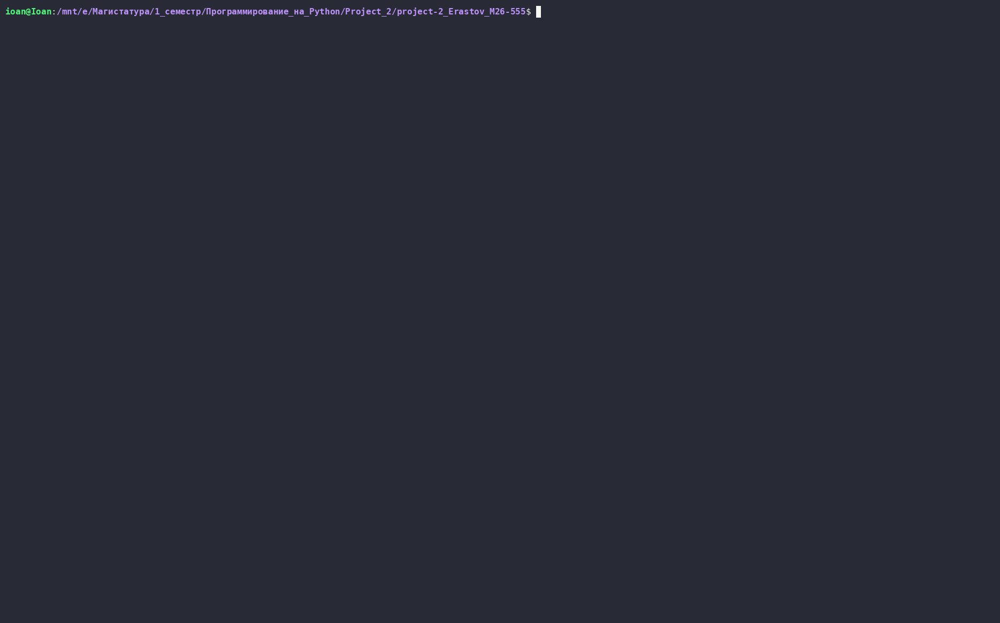

# Primitive DB

Консольная база данных на Python с поддержкой CRUD-операций, фильтрации записей и управления таблицами

## Установка

Клонируйте репозиторий:

```bash
git clone https://github.com/IvanE117/project-2_Erastov_M26-555.git
cd project-2_Erastov_M26-555
```

Установите зависимости и синхронизируйте виртуальное окружение:

```bash
uv sync
```

## Запуск

```bash
uv run database
```

## Управление таблицами

Поддерживаются следующие команды:

- `create_table` - создание таблицы;
- `list_tables` - вывод списка всех таблиц;
- `drop_table` - удаление таблицы;

CRUD-операции:

- `insert` - создание новой записи в таблицу;
- `select` - чтение всех записей или выборки по заданному условию;
- `update` - обновление значений полей существующих записей;
- `delete` - удаление записей по заданному условию;
- `info` - вывод информации о таблице;

- `help` - вывод справки по командам;
- `exit` - выход из программы.

## Подтверждение опасных действий

Перед `drop_table` и `delete` программа просит подтверждение:

```text
Введите команду: drop_table users
Вы уверены, что хотите выполнить "удаление таблицы"? [y/n]: n
Операция отменена
```

## Обработка ошибок

Ошибки (несуществующая таблица или столбец, неверный тип значения, неверное число параметров, отсутствующий файл данных) не завершают программу: выводится понятное сообщение, и можно вводить следующую команду.

```text
Введите команду: insert into users values "Sergei" abc true
Ошибка преобразования типа: "abc" не является целым числом.
```

### Поддерживаемые типы данных

- `int` - целое число;
- `str` - строка;
- `bool` - логическое значение.

## Пример использования

Создание таблицы:

```text
create_table users name:str age:int
```

Просмотр списка таблиц:

```text
list_tables
```

Удаление таблицы:

```text
drop_table users
```

Добавление записей:

```text
insert into users values "Sergei" 28 true
insert into users values "Ivan" 25 false
insert into users values "Alex" 30 true
```

Просмотр всех записей:

```text
select from users
```

Поиск записей по условию:

```text
select from users where age = 28
```

Обновление записи:

```text
update users set age = 29 where name = "Sergei"
```

Удаление записей:

```text
delete from users where name = "Ivan"
```

Просмотр информации о таблице:

```text
info users
```

Завершение работы:

```text
exit
```

## Дополнительно

- Время выполнения `insert` и `select` выводится в консоль.
- Результаты `select` с условием кэшируются, повторный одинаковый запрос к неизменённым данным выполняется без повторного поиска.
- Значения с пробелами берутся в кавычки: `"Ivan Petrov"`.
- Метаданные хранятся в `db_meta.json`, данные таблиц в `data/<имя_таблицы>.json` в текущей папке.

## Демонстрация


CRUD-операции:


Декораторы и замыкания:


